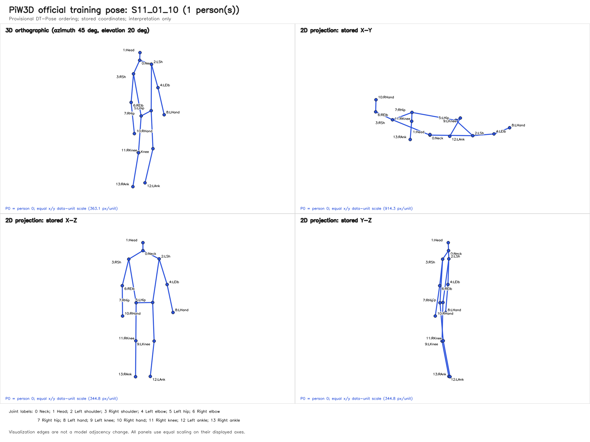
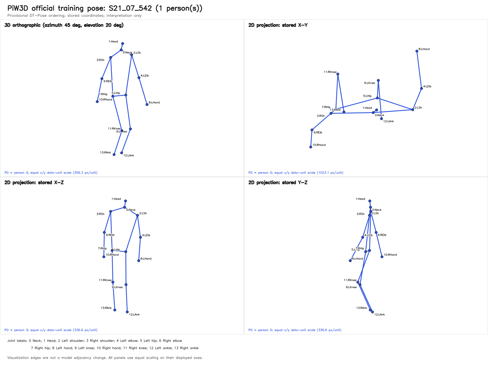
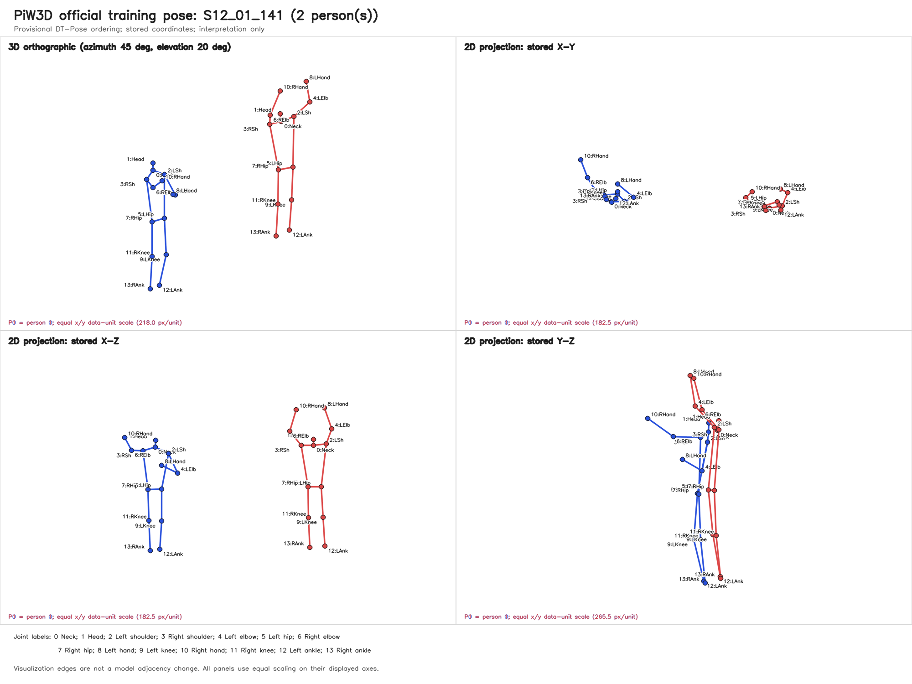
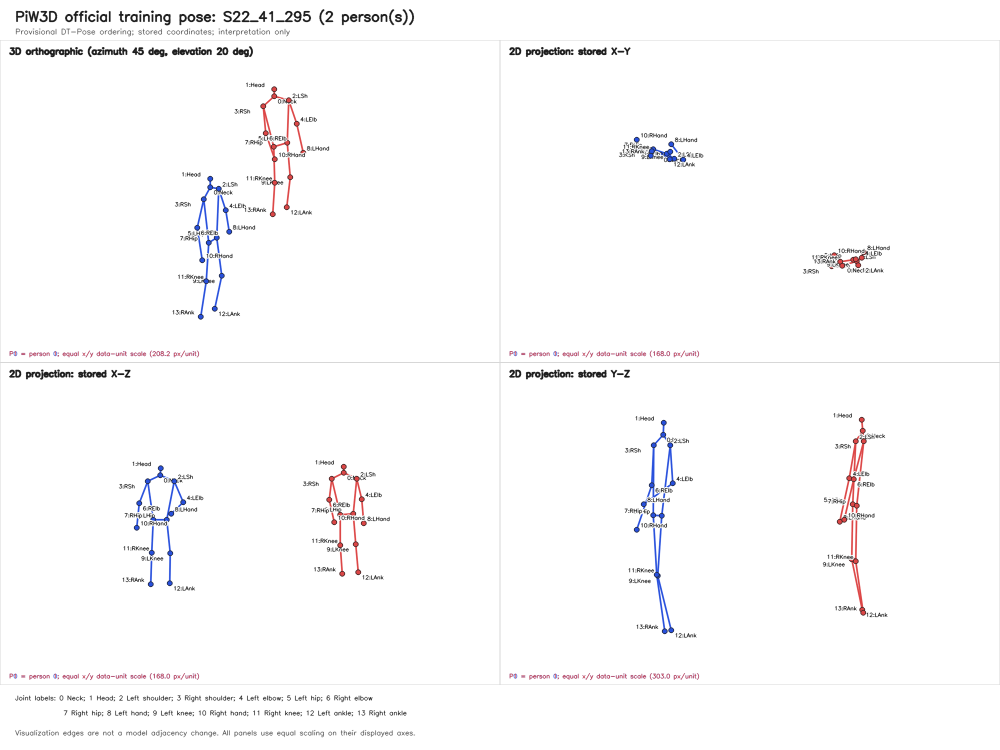
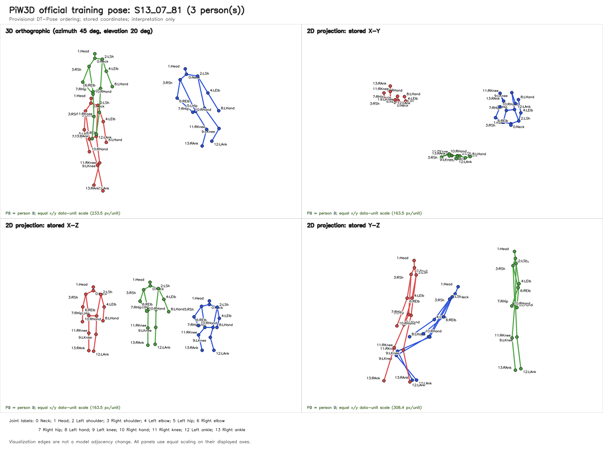
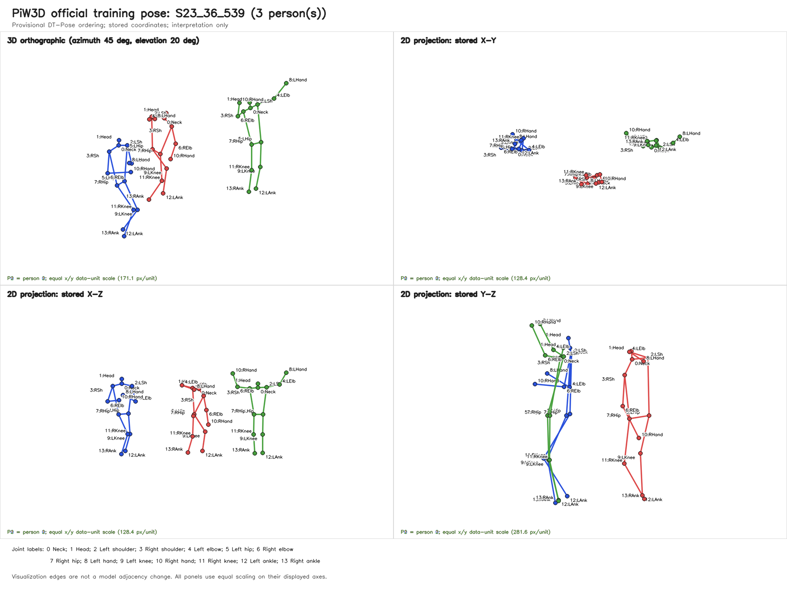

# Person-in-WiFi-3D Pose, Split, and Metric Audit

**Rating: YELLOW.** This is a read-only audit of filename semantics, bounded official training keypoints, and existing metric source code.

## Scope and access controls

- Dataset root: `J:\Zero-shot 3D Multi-person Pose Estimation\data\person_in_wifi_3d\wifi_dataset`.
- Parsed every ID in `J:\Zero-shot 3D Multi-person Pose Estimation\data\person_in_wifi_3d\wifi_dataset\train_data\train_data_list.txt` and `J:\Zero-shot 3D Multi-person Pose Estimation\data\person_in_wifi_3d\wifi_dataset\test_data\test_data_list.txt`.
- Read only the 90 selected keypoint arrays under official `train_data/keypoint`; no CSI array and no official test CSI/keypoint array was read.
- Did not import or execute `process.py`, `train_pose.py`, `pretrain.py`, or any model/training code. Their text was inspected only where stated.
- Wrote only this report and the listed PNG figures, both guarded to be outside the dataset root. No dataset file was created, renamed, moved, deleted, preprocessed, or corrected.
- Coordinate units and joint order remain interpretations unless explicitly described as verified. Missing frame numbers are not treated as corruption.

## Shared-documentation corrections (2026-11-06)

- The Person-in-WiFi 3D paper documents 600-frame clips with the **first 550 frames for training and last 50 for testing**. The released IDs measured below do not verify a literal first-550/last-50 filename-index mapping: train spans 10..599 and test spans 301..349, with no test IDs in 551..600. The paper protocol and released filename convention must therefore remain distinct; no alternative mapping is asserted. Source: [IEEE Computer Society paper record](https://www.computer.org/csdl/journal/tp/2026/10/11556388/2hbkFLqbBIs).
- The local bounded-pose audit interprets **axis 2 as vertical**, whereas the original authors' evaluation treats **axis 1 as vertical** in per-axis evaluation. These interpretations conflict. This correction does not reorder coordinates, edit poses, or declare either convention settled.
- The original authors' evaluation supports converting metre-valued errors to millimetres. The local legacy `calulate_error` path currently omits `*1000` and returns MPJPE/PA-MPJPE in stored/input units. Research metrics must state units explicitly rather than silently inheriting that omission. Upstream source: [Person-in-WiFi 3D repository](https://github.com/aiotgroup/Person-in-WiFi-3D-repo).

## Part 1 — Filename semantics

### Exact token rules used

For an ID such as `S11_01_10`, splitting on underscores gives exactly three zero-based tokens:

- **Person count:** token `0` (`S11`), character `2` (third character); `int(parts[0][2])`. This matches `feeder/person_in_wifi_3d.py:42`.
- **Candidate temporal group:** tokens `0` and `1`, joined as `parts[0] + '_' + parts[1]`; for the example, `S11_01`. This matches the feeder's next-frame key construction at `feeder/person_in_wifi_3d.py:62`.
- **Frame index:** token `2`; `int(parts[2])`.
- Expected types: token 0 matches `S` plus two decimal digits, tokens 1 and 2 contain decimal digits, and there are exactly three tokens. The other digit in token 0 is not assigned a semantic identity here.

These are **candidate temporal groups only**. No filename or supplied documentation proves that they are recording IDs, clip IDs, subject IDs, or environment IDs.

### Representative official training IDs

The 12 IDs below are deterministic evenly spaced selections (four per filename-derived person-count category) from the sorted official training list.

| ID | Tokens | Person count: token 0 char 2 | Candidate group: tokens 0-1 | Frame: token 2 |
| --- | --- | --- | --- | --- |
| `S11_01_10` | `['S11', '01', '10']` | 1 | `S11_01` | 10 |
| `S11_27_580` | `['S11', '27', '580']` | 1 | `S11_27` | 580 |
| `S21_26_555` | `['S21', '26', '555']` | 1 | `S21_26` | 555 |
| `S51_32_599` | `['S51', '32', '599']` | 1 | `S51_32` | 599 |
| `S12_01_141` | `['S12', '01', '141']` | 2 | `S12_01` | 141 |
| `S22_19_33` | `['S22', '19', '33']` | 2 | `S22_19` | 33 |
| `S52_06_498` | `['S52', '06', '498']` | 2 | `S52_06` | 498 |
| `S52_48_599` | `['S52', '48', '599']` | 2 | `S52_48` | 599 |
| `S13_07_81` | `['S13', '07', '81']` | 3 | `S13_07` | 81 |
| `S23_22_32` | `['S23', '22', '32']` | 3 | `S23_22` | 32 |
| `S23_44_425` | `['S23', '44', '425']` | 3 | `S23_44` | 425 |
| `S53_48_567` | `['S53', '48', '567']` | 3 | `S53_48` | 567 |

### Full-list validation and frame-index distributions

| Split | Listed | Unique | Duplicates | Malformed | Token-count distribution | Person counts {1,2,3} | Min | p1 | p5 | p25 | p50 | p75 | p95 | p99 | Max | Candidate groups |
| --- | --- | --- | --- | --- | --- | --- | --- | --- | --- | --- | --- | --- | --- | --- | --- | --- |
| train | 89946 | 89946 | 0 | 0 | {3: 89946} | {1: 28121, 2: 36242, 3: 25583} | 10 | 15 | 37 | 144 | 273 | 463 | 571 | 594 | 599 | 215 |
| test | 7824 | 7824 | 0 | 0 | {3: 7824} | {1: 2586, 2: 3184, 3: 2054} | 301 | 301 | 303 | 312 | 325 | 337 | 347 | 349 | 349 | 195 |

- Every listed ID valid: **True**. All IDs have three tokens of the expected types: **True**.
- Exact listed-ID overlap: **0**.
- Candidate temporal groups: train **215**, test **195**, shared **195**. Every test candidate group occurs in train: **True**.
- The official split is therefore not candidate-temporal-group disjoint. This does not by itself prove leakage, and it does not establish any recording-, subject-, or environment-level claim.

### Evidence about the first-550/last-50 protocol

No `550`, `first-550`, or `last-50` statement was found in the supplied local Markdown/Python/YAML documentation. To test the requested protocol without assuming it, a literal 1-based 600-index interpretation would put train at 1–550 and test at 551–600.

- Train IDs with frame index `<=550`: **82061/89946**.
- Test IDs with frame index `551..600`: **0/7824**; observed test range is **301..349**.
- Shared candidate groups satisfying all train `<=550` and all test `>=551`: **0/195**.
- **Conclusion:** the observed indices do not support that literal first-550/last-50 within-clip interpretation. Filename indices might use another origin or selection convention, but that is unresolved, not evidence for an alternative mapping. Gaps are observed absences, not labeled corruption.

## Part 2 — Official training-pose validation

### Deterministic sample and per-file checks

For each filename-derived person count, the audit sorted by candidate group/frame/ID and selected 30 unique evenly spaced IDs. Total: **90 training files**.

| Category | Selected official training IDs |
| --- | --- |
| 1 person | `S11_01_10`, `S11_03_471`, `S11_05_381`, `S11_07_411`, `S11_10_270`, `S11_12_162`, `S11_16_65`, `S11_17_560`, `S11_19_576`, `S11_25_468`, `S11_28_368`, `S11_30_281`, `S11_32_203`, `S21_02_95`, `S21_05_61`, `S21_07_542`, `S21_15_231`, `S21_20_123`, `S21_23_232`, `S21_26_151`, `S21_28_557`, `S21_31_61`, `S51_01_543`, `S51_07_435`, `S51_10_275`, `S51_12_238`, `S51_23_116`, `S51_27_17`, `S51_29_108`, `S51_32_599` |
| 2 person | `S12_01_141`, `S12_09_274`, `S12_14_120`, `S12_24_442`, `S12_36_416`, `S12_41_130`, `S12_47_50`, `S22_01_514`, `S22_07_447`, `S22_13_38`, `S22_19_516`, `S22_26_98`, `S22_31_378`, `S22_35_49`, `S22_37_544`, `S22_41_295`, `S22_44_576`, `S22_48_171`, `S52_02_394`, `S52_06_31`, `S52_09_382`, `S52_13_581`, `S52_16_164`, `S52_18_394`, `S52_23_581`, `S52_30_565`, `S52_36_27`, `S52_40_558`, `S52_45_170`, `S52_48_599` |
| 3 person | `S13_07_81`, `S13_16_391`, `S13_26_415`, `S13_31_267`, `S13_44_388`, `S23_01_112`, `S23_06_138`, `S23_12_272`, `S23_17_85`, `S23_18_561`, `S23_22_381`, `S23_27_146`, `S23_28_583`, `S23_30_387`, `S23_33_373`, `S23_36_539`, `S23_38_476`, `S23_40_506`, `S23_42_267`, `S23_44_80`, `S23_47_21`, `S23_48_415`, `S53_08_17`, `S53_09_497`, `S53_19_389`, `S53_24_367`, `S53_27_531`, `S53_35_67`, `S53_39_213`, `S53_48_567` |

| Check | Passed | Failed |
| --- | --- | --- |
| Shape exactly `(filename_people, 14, 3)` | 90 | 0 |
| Filename person count equals `keypoint.shape[0]` | 90 | 0 |
| All values finite | 90 | 0 |
| Array not constant | 90 | 0 |
| Read without error | 90 | 0 |

The shape check includes the count match, but both are reported separately as requested. These are bounded-sample findings, not a full-dataset integrity scan.

Per-file validation records

| ID | Shape | Shape OK | Count match | Finite | Constant | Error |
| --- | --- | --- | --- | --- | --- | --- |
| `S11_01_10` | `(1, 14, 3)` | True | True | True | False | none |
| `S11_03_471` | `(1, 14, 3)` | True | True | True | False | none |
| `S11_05_381` | `(1, 14, 3)` | True | True | True | False | none |
| `S11_07_411` | `(1, 14, 3)` | True | True | True | False | none |
| `S11_10_270` | `(1, 14, 3)` | True | True | True | False | none |
| `S11_12_162` | `(1, 14, 3)` | True | True | True | False | none |
| `S11_16_65` | `(1, 14, 3)` | True | True | True | False | none |
| `S11_17_560` | `(1, 14, 3)` | True | True | True | False | none |
| `S11_19_576` | `(1, 14, 3)` | True | True | True | False | none |
| `S11_25_468` | `(1, 14, 3)` | True | True | True | False | none |
| `S11_28_368` | `(1, 14, 3)` | True | True | True | False | none |
| `S11_30_281` | `(1, 14, 3)` | True | True | True | False | none |
| `S11_32_203` | `(1, 14, 3)` | True | True | True | False | none |
| `S21_02_95` | `(1, 14, 3)` | True | True | True | False | none |
| `S21_05_61` | `(1, 14, 3)` | True | True | True | False | none |
| `S21_07_542` | `(1, 14, 3)` | True | True | True | False | none |
| `S21_15_231` | `(1, 14, 3)` | True | True | True | False | none |
| `S21_20_123` | `(1, 14, 3)` | True | True | True | False | none |
| `S21_23_232` | `(1, 14, 3)` | True | True | True | False | none |
| `S21_26_151` | `(1, 14, 3)` | True | True | True | False | none |
| `S21_28_557` | `(1, 14, 3)` | True | True | True | False | none |
| `S21_31_61` | `(1, 14, 3)` | True | True | True | False | none |
| `S51_01_543` | `(1, 14, 3)` | True | True | True | False | none |
| `S51_07_435` | `(1, 14, 3)` | True | True | True | False | none |
| `S51_10_275` | `(1, 14, 3)` | True | True | True | False | none |
| `S51_12_238` | `(1, 14, 3)` | True | True | True | False | none |
| `S51_23_116` | `(1, 14, 3)` | True | True | True | False | none |
| `S51_27_17` | `(1, 14, 3)` | True | True | True | False | none |
| `S51_29_108` | `(1, 14, 3)` | True | True | True | False | none |
| `S51_32_599` | `(1, 14, 3)` | True | True | True | False | none |
| `S12_01_141` | `(2, 14, 3)` | True | True | True | False | none |
| `S12_09_274` | `(2, 14, 3)` | True | True | True | False | none |
| `S12_14_120` | `(2, 14, 3)` | True | True | True | False | none |
| `S12_24_442` | `(2, 14, 3)` | True | True | True | False | none |
| `S12_36_416` | `(2, 14, 3)` | True | True | True | False | none |
| `S12_41_130` | `(2, 14, 3)` | True | True | True | False | none |
| `S12_47_50` | `(2, 14, 3)` | True | True | True | False | none |
| `S22_01_514` | `(2, 14, 3)` | True | True | True | False | none |
| `S22_07_447` | `(2, 14, 3)` | True | True | True | False | none |
| `S22_13_38` | `(2, 14, 3)` | True | True | True | False | none |
| `S22_19_516` | `(2, 14, 3)` | True | True | True | False | none |
| `S22_26_98` | `(2, 14, 3)` | True | True | True | False | none |
| `S22_31_378` | `(2, 14, 3)` | True | True | True | False | none |
| `S22_35_49` | `(2, 14, 3)` | True | True | True | False | none |
| `S22_37_544` | `(2, 14, 3)` | True | True | True | False | none |
| `S22_41_295` | `(2, 14, 3)` | True | True | True | False | none |
| `S22_44_576` | `(2, 14, 3)` | True | True | True | False | none |
| `S22_48_171` | `(2, 14, 3)` | True | True | True | False | none |
| `S52_02_394` | `(2, 14, 3)` | True | True | True | False | none |
| `S52_06_31` | `(2, 14, 3)` | True | True | True | False | none |
| `S52_09_382` | `(2, 14, 3)` | True | True | True | False | none |
| `S52_13_581` | `(2, 14, 3)` | True | True | True | False | none |
| `S52_16_164` | `(2, 14, 3)` | True | True | True | False | none |
| `S52_18_394` | `(2, 14, 3)` | True | True | True | False | none |
| `S52_23_581` | `(2, 14, 3)` | True | True | True | False | none |
| `S52_30_565` | `(2, 14, 3)` | True | True | True | False | none |
| `S52_36_27` | `(2, 14, 3)` | True | True | True | False | none |
| `S52_40_558` | `(2, 14, 3)` | True | True | True | False | none |
| `S52_45_170` | `(2, 14, 3)` | True | True | True | False | none |
| `S52_48_599` | `(2, 14, 3)` | True | True | True | False | none |
| `S13_07_81` | `(3, 14, 3)` | True | True | True | False | none |
| `S13_16_391` | `(3, 14, 3)` | True | True | True | False | none |
| `S13_26_415` | `(3, 14, 3)` | True | True | True | False | none |
| `S13_31_267` | `(3, 14, 3)` | True | True | True | False | none |
| `S13_44_388` | `(3, 14, 3)` | True | True | True | False | none |
| `S23_01_112` | `(3, 14, 3)` | True | True | True | False | none |
| `S23_06_138` | `(3, 14, 3)` | True | True | True | False | none |
| `S23_12_272` | `(3, 14, 3)` | True | True | True | False | none |
| `S23_17_85` | `(3, 14, 3)` | True | True | True | False | none |
| `S23_18_561` | `(3, 14, 3)` | True | True | True | False | none |
| `S23_22_381` | `(3, 14, 3)` | True | True | True | False | none |
| `S23_27_146` | `(3, 14, 3)` | True | True | True | False | none |
| `S23_28_583` | `(3, 14, 3)` | True | True | True | False | none |
| `S23_30_387` | `(3, 14, 3)` | True | True | True | False | none |
| `S23_33_373` | `(3, 14, 3)` | True | True | True | False | none |
| `S23_36_539` | `(3, 14, 3)` | True | True | True | False | none |
| `S23_38_476` | `(3, 14, 3)` | True | True | True | False | none |
| `S23_40_506` | `(3, 14, 3)` | True | True | True | False | none |
| `S23_42_267` | `(3, 14, 3)` | True | True | True | False | none |
| `S23_44_80` | `(3, 14, 3)` | True | True | True | False | none |
| `S23_47_21` | `(3, 14, 3)` | True | True | True | False | none |
| `S23_48_415` | `(3, 14, 3)` | True | True | True | False | none |
| `S53_08_17` | `(3, 14, 3)` | True | True | True | False | none |
| `S53_09_497` | `(3, 14, 3)` | True | True | True | False | none |
| `S53_19_389` | `(3, 14, 3)` | True | True | True | False | none |
| `S53_24_367` | `(3, 14, 3)` | True | True | True | False | none |
| `S53_27_531` | `(3, 14, 3)` | True | True | True | False | none |
| `S53_35_67` | `(3, 14, 3)` | True | True | True | False | none |
| `S53_39_213` | `(3, 14, 3)` | True | True | True | False | none |
| `S53_48_567` | `(3, 14, 3)` | True | True | True | False | none |

### Coordinate statistics

Statistics aggregate all 2520 joints from all people in the 90 valid sampled training files. Values are in stored coordinate units.

| Axis | Min | Max | p1 | p5 | p25 | p50 | p75 | p95 | p99 |
| --- | --- | --- | --- | --- | --- | --- | --- | --- | --- |
| x (axis 0) | -0.229248 | 3.53717 | 0.185855 | 0.432167 | 0.849693 | 1.82346 | 2.78745 | 3.15837 | 3.33667 |
| y (axis 1) | 0.190898 | 2.84785 | 0.483278 | 0.684577 | 1.10389 | 1.40441 | 1.85217 | 2.39654 | 2.64973 |
| z (axis 2) | 2.16395 | 4.15924 | 2.40066 | 2.58842 | 2.83285 | 3.21646 | 3.60903 | 4.02543 | 4.07166 |

Extreme coordinate locations (not automatic errors):

| Axis | Extreme | ID | Person (zero-based) | Joint | Value |
| --- | --- | --- | --- | --- | --- |
| x (axis 0) | min | `S23_33_373` | 2 | 10 Right hand | -0.229248 |
| x (axis 0) | max | `S23_27_146` | 0 | 8 Left hand | 3.53717 |
| y (axis 1) | min | `S23_38_476` | 1 | 4 Left elbow | 0.190898 |
| y (axis 1) | max | `S13_44_388` | 2 | 3 Right shoulder | 2.84785 |
| z (axis 2) | min | `S23_44_80` | 1 | 10 Right hand | 2.16395 |
| z (axis 2) | max | `S53_27_531` | 2 | 12 Left ankle | 4.15924 |

A conservative Tukey outer-fence screen (`Q1 - 3*IQR`, `Q3 + 3*IQR`) is shown only to locate unusual values. No point was removed or corrected.

| Axis | Lower fence | Upper fence | Outside | Outside % |
| --- | --- | --- | --- | --- |
| x (axis 0) | -4.96357 | 8.6007 | 0 | 0 |
| y (axis 1) | -1.14093 | 4.09699 | 0 | 0 |
| z (axis 2) | 0.504303 | 5.93757 | 0 | 0 |

### Provisional scale and vertical-axis interpretation

The joint order used here is the user-supplied provisional DT-Pose order, not independently verified dataset metadata. Under that order, head-minus-mean-ankle differences give:

| Axis | Median signed head - ankles | Median absolute | Absolute p5 | Absolute p95 |
| --- | --- | --- | --- | --- |
| x (axis 0) | -0.00813446 | 0.0418826 | 0.0048688 | 0.1597 |
| y (axis 1) | -0.000301805 | 0.0372841 | 0.00377037 | 0.391677 |
| z (axis 2) | -1.33178 | 1.33178 | 1.00323 | 1.45256 |

- **Axis 2 (`z`) appears vertical.** Its median signed head-minus-ankle difference is **-1.33178**, so values increase downward in these samples (head has the smaller vertical coordinate).
- Median absolute head-to-ankle vertical separation is **1.33178 stored units**. Together with the major-limb lengths below, this is consistent with a plausible **metre-scale** interpretation.
- Metres are an interpretation supported by body proportions, not a proven unit declaration. Axis origin, camera/world frame, handedness, and official joint order remain unresolved.

### Major-limb bone lengths

All lengths are Euclidean distances in stored units. Outlier counts use the ordinary Tukey 1.5*IQR rule per bone and are diagnostic only.

| Bone | N | Mean | Std | Min | p1 | p5 | p25 | p50 | p75 | p95 | p99 | Max | Tukey outliers |
| --- | --- | --- | --- | --- | --- | --- | --- | --- | --- | --- | --- | --- | --- |
| Left upper arm (2-4) | 180 | 0.270109 | 0.0187752 | 0.208267 | 0.220009 | 0.234455 | 0.257925 | 0.274063 | 0.28438 | 0.293884 | 0.305207 | 0.311444 | 2 |
| Right upper arm (3-6) | 180 | 0.274239 | 0.0190417 | 0.209907 | 0.222467 | 0.241754 | 0.262029 | 0.275583 | 0.288923 | 0.300796 | 0.309383 | 0.321393 | 2 |
| Left forearm (4-8) | 180 | 0.293096 | 0.0270408 | 0.225209 | 0.240082 | 0.248453 | 0.275417 | 0.291631 | 0.313096 | 0.334799 | 0.352112 | 0.36449 | 0 |
| Right forearm (6-10) | 180 | 0.301319 | 0.0265302 | 0.237995 | 0.244266 | 0.263035 | 0.280458 | 0.299961 | 0.318707 | 0.343551 | 0.360846 | 0.365091 | 0 |
| Left thigh (5-9) | 180 | 0.393588 | 0.025823 | 0.32035 | 0.32808 | 0.353104 | 0.372699 | 0.397243 | 0.412208 | 0.43386 | 0.443133 | 0.469784 | 0 |
| Right thigh (7-11) | 180 | 0.394048 | 0.0255227 | 0.321927 | 0.327264 | 0.353353 | 0.373967 | 0.397167 | 0.413195 | 0.430549 | 0.444999 | 0.463052 | 0 |
| Left shin (9-12) | 180 | 0.36734 | 0.0252485 | 0.289086 | 0.297915 | 0.324046 | 0.349836 | 0.371814 | 0.386801 | 0.40194 | 0.414574 | 0.426196 | 2 |
| Right shin (11-13) | 180 | 0.371755 | 0.025625 | 0.292887 | 0.304476 | 0.325297 | 0.353772 | 0.374495 | 0.392347 | 0.409324 | 0.42683 | 0.428801 | 1 |

| Bone | Extreme | ID | Person | Provisional joints | Length |
| --- | --- | --- | --- | --- | --- |
| Left upper arm (2-4) | shortest | `S52_23_581` | 1 | Left shoulder / Left elbow | 0.208267 |
| Left upper arm (2-4) | longest | `S23_36_539` | 0 | Left shoulder / Left elbow | 0.311444 |
| Right upper arm (3-6) | shortest | `S52_23_581` | 1 | Right shoulder / Right elbow | 0.209907 |
| Right upper arm (3-6) | longest | `S23_36_539` | 0 | Right shoulder / Right elbow | 0.321393 |
| Left forearm (4-8) | shortest | `S51_29_108` | 0 | Left elbow / Left hand | 0.225209 |
| Left forearm (4-8) | longest | `S23_33_373` | 2 | Left elbow / Left hand | 0.36449 |
| Right forearm (6-10) | shortest | `S53_19_389` | 0 | Right elbow / Right hand | 0.237995 |
| Right forearm (6-10) | longest | `S53_39_213` | 0 | Right elbow / Right hand | 0.365091 |
| Left thigh (5-9) | shortest | `S22_07_447` | 1 | Left hip / Left knee | 0.32035 |
| Left thigh (5-9) | longest | `S23_36_539` | 0 | Left hip / Left knee | 0.469784 |
| Right thigh (7-11) | shortest | `S22_07_447` | 1 | Right hip / Right knee | 0.321927 |
| Right thigh (7-11) | longest | `S23_36_539` | 0 | Right hip / Right knee | 0.463052 |
| Left shin (9-12) | shortest | `S52_23_581` | 1 | Left knee / Left ankle | 0.289086 |
| Left shin (9-12) | longest | `S53_24_367` | 1 | Left knee / Left ankle | 0.426196 |
| Right shin (11-13) | shortest | `S52_23_581` | 1 | Right knee / Right ankle | 0.292887 |
| Right shin (11-13) | longest | `S23_06_138` | 1 | Right knee / Right ankle | 0.428801 |

Short or long bones may reflect pose, annotation noise, joint-order mismatch, or genuine outliers. This audit does not delete, clamp, or correct them.

### Generated and inspected visualizations

Each PNG contains the official training sample ID, per-joint labels, a labelled 3D orthographic skeleton view, and X-Y/X-Z/Y-Z 2D projections. Every panel uses one common data-unit scale on its displayed axes. The edges are visualization-only and do not modify any model adjacency matrix.

All six PNGs were opened and visually inspected after generation. The two one-person figures, two two-person figures, and two three-person figures show the expected number of color-coded people and coherent head/trunk/limb structures under the provisional joint ordering. Axis 2 is visually consistent with the vertical interpretation. Multi-person spatial separation is visible, while some adjacent joints and labels overlap in the X-Y projections and crowded three-person views; this limits fine visual inspection but does not change the numerical results. No figure was used to infer official units, subject/environment identity, or model connectivity.

- [1p_S11_01_10.png](figures/pose_audit/1p_S11_01_10.png)

- [1p_S21_07_542.png](figures/pose_audit/1p_S21_07_542.png)

- [2p_S12_01_141.png](figures/pose_audit/2p_S12_01_141.png)

- [2p_S22_41_295.png](figures/pose_audit/2p_S22_41_295.png)

- [3p_S13_07_81.png](figures/pose_audit/3p_S13_07_81.png)

- [3p_S23_36_539.png](figures/pose_audit/3p_S23_36_539.png)

## Part 3 — Metric audit (source inspection only)

### MPJPE and PA-MPJPE units

- `calulate_error` at `utils.py:184` computes Euclidean coordinate differences at `utils.py:200` and `utils.py:211` and performs **no multiplication by 1000**. MPJPE, PA-MPJPE, and both per-joint arrays are returned in the **same units as the stored/input coordinates** at `utils.py:217`.
- If stored coordinates are metres, apply `*1000` exactly once to all four returned arrays (`mpjpe`, `pampjpe`, `mpjpe_joints`, `pampjpe_joints`) immediately before `utils.py:217`, or immediately after the call at `train_pose.py:296`. This covers both person-averaged and per-joint values. Alternatively, converting only the final display averages would not convert per-joint outputs.
- PCK is dimensionless because distances are divided by a pose-derived scale; it does not need a metre-to-millimetre conversion.
- No metric code was edited in this task.

### Current PiW3D PCK normalization

- The `person-in-wifi-3d` branch at `utils.py:104` computes `||gt[:,:,6] - gt[:,:,4]||`. Under the provisional ordering, these are **right elbow (6)** and **left elbow (4)**, so the normalizer is inter-elbow distance, not the source comment's shoulder-to-hip/torso diameter.
- At `utils.py:107`, each 3D joint error is divided by that distance. `train_pose.py:294-295` uses thresholds `0.5, 0.4, 0.3, 0.2, 0.1` times the normalizer and reports percent PCK. Close elbows make the denominator small and PCK stricter; there is no zero/near-zero scale guard.
- This finding depends on the provisional joint order for semantic naming; the actual indices 6 and 4 are directly verified in code.

### Other behavior relevant to missed/duplicate people and interpretation

- `train_pose.py:283` and the following ground-truth line use label-derived `person_num` to retain only the first N prediction slots and first N padded ground-truth people. Extra slots are excluded, so missed-person count, duplicate-person count, and exact count accuracy cannot be measured by this evaluation path.
- Predicted and ground-truth people are paired by slot/index order; there is no Hungarian matching. A permutation can inflate pose error, while trimming can hide duplicates.
- PA-MPJPE calls Procrustes alignment with `compute_optimal_scale=True` at `utils.py:209`; translation, rotation, and scale differences can be hidden. It is not root-localization error.
- The optional `align=True` path calls joint 0 a hip at `utils.py:192`, but joint 0 is Neck under the provisional PiW3D order. Current calls use `align=False`, so this neck-alignment issue is latent rather than active here.
- Per-batch PCK arrays are averaged equally at `train_pose.py:306` rather than pooled by joint/person count; unequal final batch sizes can change weighting.
- MPJPE averages joints per person and then persons; alone it does not penalize a missing or duplicate person. No root-localization, missed/duplicate, count-accuracy, or person-level precision/recall/F1 implementation was found in this path.

## Verified facts

- Both official lists were fully parsed: 89946 train and 7824 test unique IDs; all IDs matched the expected token structure.
- The bounded official training sample contains 90 files (30 per person-count category); all shape/count/finite/nonconstant checks passed: **True**.
- Axis 2 appears vertical and stored coordinates are plausibly metre-scale based on the sampled body proportions.
- The code uses PCK joints 6 and 4, returns MPJPE/PA-MPJPE without `*1000`, trims predictions with ground-truth person counts, and performs no Hungarian matching.
- Six requested figure sets were generated: **6 PNGs**.

## Unresolved facts and assumptions

- No independent metadata was found proving coordinate units, joint ordering, coordinate origin/frame, or candidate-group semantics.
- Metre scale and the vertical-axis interpretation are empirical interpretations of the provisional joint ordering, not official convention confirmation.
- The first-550/last-50 documentation was not present locally; only a literal interpretation was tested and rejected by observed indices.
- Numerical pose validation is bounded to 90 training files. Full-dataset readability, NaN/Inf status, and bone distributions were not measured.

## Rating rationale

- GREEN is not justified because official units/joint order and candidate temporal group semantics are not independently established.
- The observed indices reject the literal first-550/last-50 interpretation, and all test candidate groups overlap train groups.
- The current PCK normalizer is inter-elbow distance under the provisional ordering, and GT-count trimming prevents missed/duplicate/count evaluation.
- All 90 bounded training-pose structure, count, finiteness, and nonconstant checks passed, so the sample did not justify RED.

## Generated files

- `docs/POSE_SPLIT_METRIC_AUDIT.md`
- `docs\figures\pose_audit\1p_S11_01_10.png`
- `docs\figures\pose_audit\1p_S21_07_542.png`
- `docs\figures\pose_audit\2p_S12_01_141.png`
- `docs\figures\pose_audit\2p_S22_41_295.png`
- `docs\figures\pose_audit\3p_S13_07_81.png`
- `docs\figures\pose_audit\3p_S23_36_539.png`

No preprocessing, training, package installation, commit, or push occurred.
